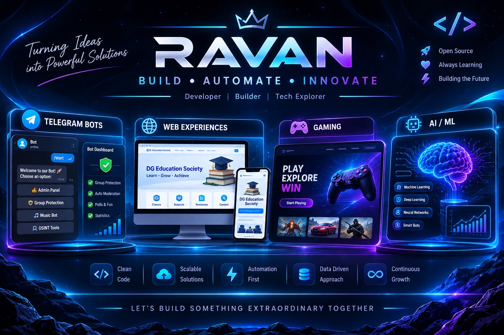
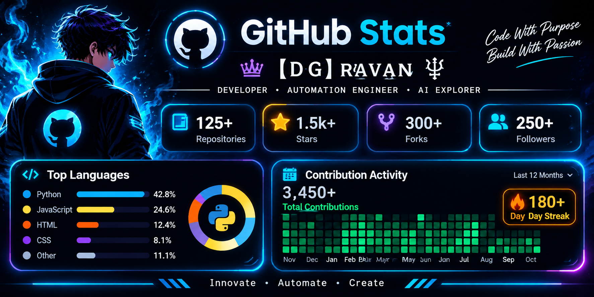
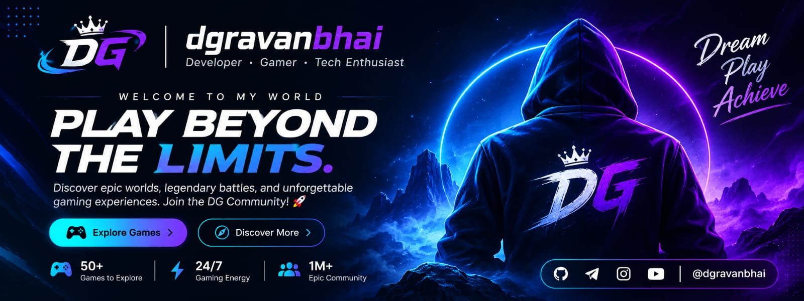

 
<!-- ===================================================== -->
<!--                 RAVAN | GITHUB PROFILE                -->
<!-- ===================================================== -->

👑 【ＤＧ】ʀᴀᴠᴀɴ 🜲 | Developer • Automation Engineer • AI Explorer

  

<h1 align="center">⚡ BUILD. AUTOMATE. INNOVATE. ⚡</h1>

  <b>Turning Ideas Into Powerful Digital Solutions</b>

  
  
  

  

## 👨‍💻 ABOUT ME

I'm a developer passionate about building useful digital products, automation systems, and intelligent applications.

- 🤖 Developing Telegram bots and group management systems.
- 🌐 Building static and dynamic websites.
- 🎮 Exploring interactive gaming website experiences.
- 🧠 Exploring Artificial Intelligence and Machine Learning.
- ⚙️ Interested in backend development and automation.
- 💡 Always learning, experimenting, and building new ideas.

**My goal:** Turn creative ideas into practical digital solutions.

---

## 🚀 WHAT I BUILD

<table>
<tr>
<td width="50%" valign="top">

### 🤖 Telegram Bot Development

- Group management bots
- Group protection systems
- Force subscription bots
- Music bots
- AI-powered bot experiments
- OSINT and automation tools

</td>
<td width="50%" valign="top">

### 🌐 Web Development

- Static websites
- Dynamic web applications
- Gaming websites
- Portfolio websites
- Educational platforms
- Responsive user interfaces

</td>
</tr>
<tr>
<td width="50%" valign="top">

### 🧠 AI & Machine Learning

- Artificial Intelligence exploration
- Machine Learning concepts
- Deep Learning exploration
- NLP and intelligent automation
- AI-powered application experiments

</td>
<td width="50%" valign="top">

### ⚙️ Backend & Automation

- Python development
- API integrations
- Database management
- Workflow automation
- Server-side applications
- GitHub-based deployments

</td>
</tr>
</table>

---

## 🤖 TELEGRAM BOT PROJECTS

  <b>Building Telegram bots focused on automation, music, community management, and intelligent features.</b>

<table>
<tr>
<th>PROJECT</th>
<th>DESCRIPTION</th>
<th>REPOSITORY</th>
</tr>
<tr>
<td>🎵 Repomusic</td>
<td>Telegram music bot project</td>
<td><a href="https://github.com/dgravanbhaii/Repomusic">View Project</a></td>
</tr>
<tr>
<td>🛡️ Force Subscribe</td>
<td>Telegram force subscription bot</td>
<td><a href="https://github.com/dgravanbhaii/force_to_join">View Project</a></td>
</tr>
<tr>
<td>👥 Lucky Group Management</td>
<td>Telegram group management project</td>
<td><a href="https://github.com/dgravanbhaii/Lucky---Group-Management-Bot">View Project</a></td>
</tr>
<tr>
<td>🧠 Telegram AI Project</td>
<td>AI-focused Telegram bot project</td>
<td><a href="https://github.com/dgravanbhaii/Telegram-AI-Project-Bot">View Project</a></td>
</tr>
<tr>
<td>🎧 ShrutiMusic</td>
<td>Telegram music bot project</td>
<td><a href="https://github.com/dgravanbhaii/ShrutiMusic">View Project</a></td>
</tr>
<tr>
<td>🔐 Session String</td>
<td>Telegram session generation project</td>
<td><a href="https://github.com/dgravanbhaii/Session-String1">View Project</a></td>
</tr>
</table>

---

## 🌐 WEB DEVELOPMENT SHOWCASE

| PROJECT | CATEGORY | LINK |
|---|---|---|
| DG Education Society | Educational Portal | Coming Soon |
| Nexus Gaming | Gaming Website | [Live Demo](https://dgravanbhaii.github.io/Nexus-Gaming/) |
| Static Web Projects | Web Development | Explore Repositories |
| Dynamic Web Projects | Web Applications | Explore Repositories |

---

## 🧠 AI, MACHINE LEARNING & DEEP LEARNING

I'm exploring the technologies behind intelligent applications and modern AI systems.

**Areas of interest:**

- Artificial Intelligence (AI)
- Machine Learning (ML)
- Deep Learning (DL)
- Natural Language Processing (NLP)
- Intelligent Chatbots
- Automation and Predictive Systems

**Technologies I'm exploring:**

  
  
  
  
  

---

## 🛠️ TECHNOLOGY STACK

### Programming Languages

  

### Frameworks & Backend

  

### Databases

  

### Tools & Platforms

  

---

## 📊 GITHUB ANALYTICS

<h2 align="center">⚡ GITHUB STATS</h2>

  

  

---

## 🐍 CONTRIBUTION ACTIVITY

<h2 align="center">🐍 CONTRIBUTION ACTIVITY</h2>

  

name: Generate Contribution Snake

on:
  schedule:
    - cron: "0 */12 * * *"
  workflow_dispatch:
  push:
    branches:
      - main

jobs:
  generate:
    permissions:
      contents: write

    runs-on: ubuntu-latest

    steps:
      - name: Generate Snake Animation
        uses: Platane/snk@v3
        with:
          github_user_name: dgravanbhaii
          outputs: |
            dist/github-contribution-grid-snake.svg
            dist/github-contribution-grid-snake-dark.svg?palette=github-dark

      - name: Publish Snake Animation
        uses: crazy-max/ghaction-github-pages@v4
        with:
          target_branch: output
          build_dir: dist
        env:
          GITHUB_TOKEN: ${{ secrets.GITHUB_TOKEN }}

## 🤝 CONNECT WITH ME

  
  
  

  💬 Open to collaboration, interesting projects, and learning opportunities.

---

<h2 align="center">🎮 NEXUS GAMING — PROJECT SHOWCASE</h2>

  

  <b>AN INTERACTIVE GAMING WEB EXPERIENCE</b>
   
  Designed and published by Ravan.

  
  

  <i>Thanks for visiting my GitHub profile. Let's build something extraordinary together! 🚀</i>

